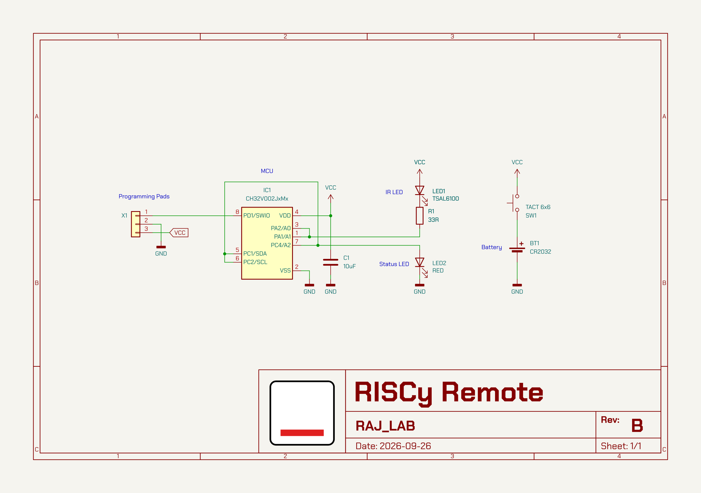
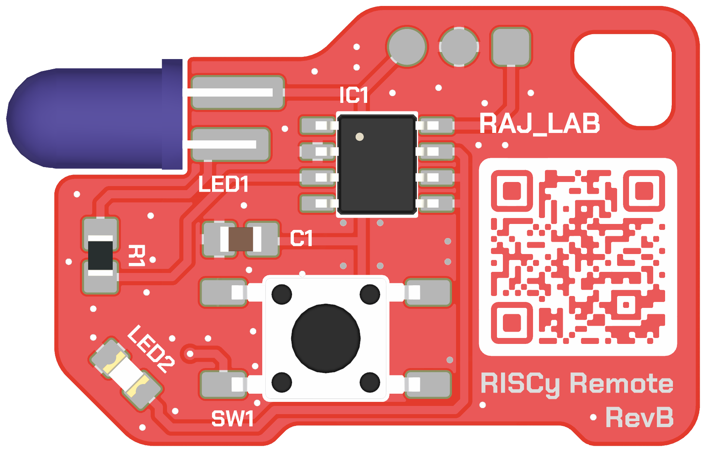
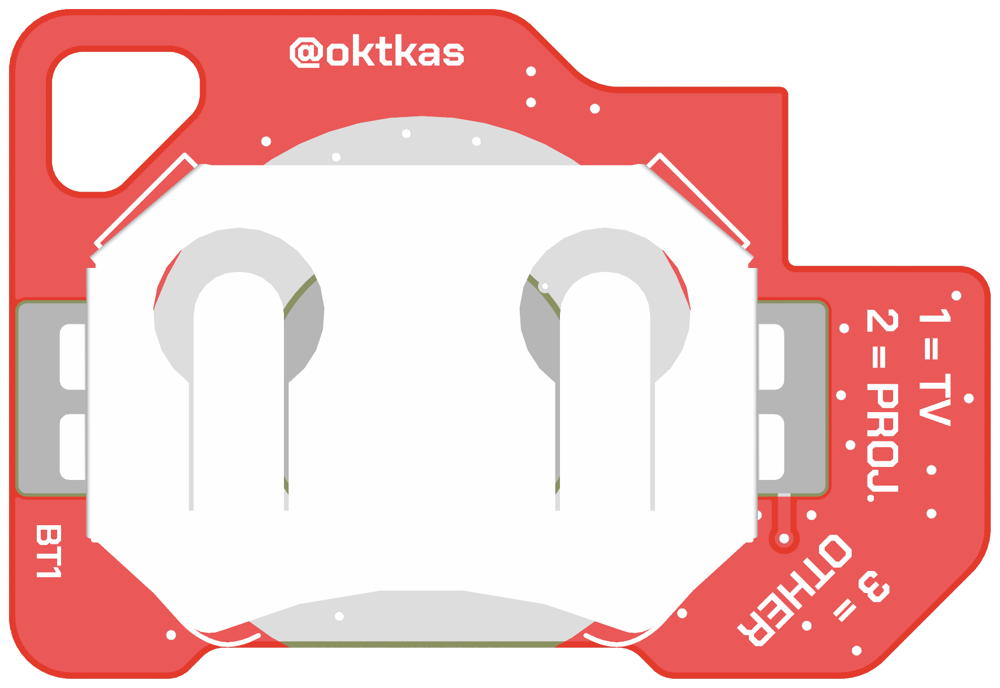

# Simple Exports

A KiCad PCB editor plugin that writes three images into an `img` folder next
to the board:

- `front.png` and `back.png`: unshaded orthographic 3D renders in the board's
  stackup colours, trimmed to the board on a transparent background. They use
  your 3D viewer's render settings with shadows, reflections, post-processing
  and the floor turned off (in a temporary copy; your settings are untouched)
- `schematic.png`: the root schematic sheet, 2400 px wide

The toolbar button opens a small window where you pick:

- which images to write (all three by default)
- the render style:
  - *Unshaded* (above, the default)
  - *Shaded*: your 3D viewer's settings with shadows, reflections and
    post-processing on (floor still off, so the background stays
    transparent); slower
  - *Basic*: kicad-cli's basic quality, with flatter, more saturated mask
    colours, though copper under the mask can tint light masks
- whether each render also shows the parts mounted on the other side, such as
  a connector sticking out past the edge (off by default)

The window remembers your choices until KiCad closes.

With the defaults, the RISCy Remote, a small IR remote board, gives:

<div align="center">
  
</div>

<div align="center">
  
  
</div>

It works on any project with no per-board setup. Parts are drawn from their
3D models. Rendering uses `kicad-cli` from the running KiCad, and the
schematic is rasterised with Inkscape when installed (otherwise with
wxWidgets, which leaves out embedded bitmaps such as title-block logos).
kicad-cli works on the saved files, so the plugin offers to save a modified
board first. Progress and the result appear in one small window; *Cancel*
stops the running tool and keeps the images already finished.

Tested with KiCad 10 on Windows.

## Install

1. Download `simple-exports-<version>.zip` from the
   [latest release](https://github.com/oktkas/simple-exports/releases/latest).
   Don't unzip it.
2. In KiCad, open *Plugin and Content Manager*, click *Install from File...*
   and pick the zip.
3. Restart the PCB editor.

The button appears in the top toolbar and under *Tools → External Plugins*.
Update by installing a newer zip the same way; remove it from the
*Installed* tab.

## Development

`python package.py` builds the release zip into `dist/` from
`metadata.json`, `plugins/` and `resources/icon.png`. Bump the version in
`metadata.json` first.

To run from a checkout instead, link the `plugins` folder into KiCad's
plugin directory (don't also install the zip, or the button shows twice),
then restart the PCB editor or use
*Tools → External Plugins → Refresh Plugins*:

```powershell
New-Item -ItemType Junction `
  -Path "$env:USERPROFILE\Documents\KiCad\10.0\scripting\plugins\simple_exports" `
  -Target "$PWD\plugins"
```

## Outside KiCad

`plugins/export.py` does not need pcbnew, so it can run in KiCad's Python:

```powershell
& "C:\Program Files\KiCad\10.0\bin\python.exe" plugins\export.py path\to\board.kicad_pcb
```

Options match the window: `--only front back schematic`,
`--style unshaded|shaded|basic` and `--other-side`.

## Licence

The code is MIT licensed; see [LICENSE](LICENSE).

`logo.svg`, `logo.png` and the icons rendered from them are not covered by
that licence: the logo is "Image" by Kasanah from the Noun Project
(<https://thenounproject.com/icon/image-8290303/>), used under CC BY 3.0,
recoloured.
`plugins/icon.png` (24 px, toolbar), `plugins/icon_48.png` (dialog) and
`resources/icon.png` (64 px, Plugin and Content Manager) are rendered from
`logo.svg`, cropped to the drawing:

```powershell
inkscape logo.svg --export-area-drawing -w 24 -h 24 --export-filename=plugins\icon.png
```
